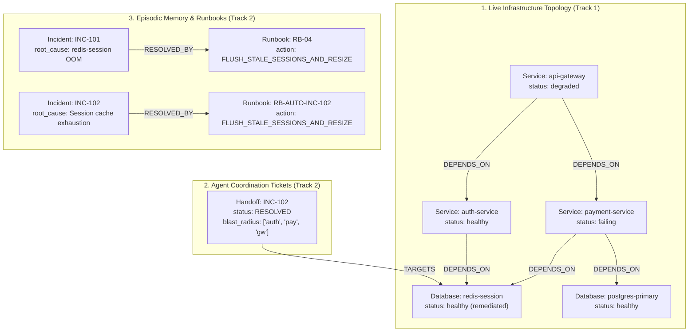

# GraphOps: Autonomous Incident Triage & Stateful Multi-Agent Coordination via FalkorDB

[](https://www.falkordb.com/)
[](https://ai.google.dev/)
[](#hackathon-track-eligibility)
[](#hackathon-track-eligibility)
[](LICENSE)

An autonomous, multi-agent Site Reliability Engineering (SRE) and DevOps incident response system built for the **FalkorDB "Graph Hacks" Hackathon**. 

**GraphOps** replaces brittle procedural runbooks and stateless LLM pipelines with an asynchronous, graph-native multi-agent architecture. Two specialized AI agents communicate statefully and asynchronously using **FalkorDB** as their shared nervous system and external memory store—tracing multi-hop failure propagation in real time and self-healing cloud infrastructure without shared Python memory variables.

---

## 1. What does this project do, and why did you build it?

### The Problem
Modern microservice environments fail in complex, cascading ways. When a low-level service (such as a session cache or database) crashes or experiences an Out-Of-Memory (`oom_killed`) event, latency and error spikes propagate upstream across multiple service boundaries, degrading client-facing edge gateways.

Traditional automated incident triage solutions suffer from three fundamental architectural flaws:
1. **Lack of Structural Topology Awareness:** Flat log aggregators and vector databases only calculate semantic similarity between textual alerts. They are blind to physical and logical architecture: they cannot traverse multi-hop directional dependency graphs (`Service A -> Service B -> Database C`) to accurately compute the blast radius or pinpoint the true root-cause component.
2. **Session Amnesia:** Standard LLM agents are stateless across sessions. When an incident is resolved, the diagnosis, root-cause correlation, and remediation runbook are lost when the process terminates. Subsequent incidents must re-diagnose identical failures from scratch, repeating mistakes and increasing Mean Time to Resolution (MTTR).
3. **In-Memory Agent Coupling (Anti-Pattern):** Most multi-agent frameworks (e.g., AutoGen, CrewAI) pass memory state through in-process Python variables, shared dictionaries, or thread contexts. This tightly coupled architecture cannot scale across independent worker processes, cannot survive process crashes, and prevents true asynchronous task handoffs.

### The Solution: GraphOps
**GraphOps** establishes **FalkorDB** as the persistent, external graph nervous system that decouples incident operations into two autonomous, single-responsibility agents:

1. **Agent 1: Diagnostic Agent**
   - Ingests raw, unstructured operational alert payloads (e.g., edge gateway timeouts and database OOM notifications).
   - Traverses the live microservice topology in FalkorDB using multi-hop OpenCypher queries (`<-[:DEPENDS_ON*1..3]-`) to identify the true root-cause node and calculate the exact blast radius.
   - Creates an immutable, stateful `:Handoff` ticket node in FalkorDB with status `PENDING_REMEDIATION` and links it via a `[:TARGETS]` edge to the culprit component.
   - Concludes its execution and terminates cleanly.

2. **Agent 2: Remediation Agent**
   - Operates completely decoupled from Agent 1 with **zero shared Python in-memory state**.
   - Asynchronously scans FalkorDB for active `PENDING_REMEDIATION` handoff tickets.
   - Queries FalkorDB episodic memory (`(:Incident)-[:RESOLVED_BY]->(:Runbook)`) to retrieve proven remediation actions for the diagnosed failure pattern.
   - Executes the targeted remediation action (e.g., flushing stale session keys and dynamically resizing memory limits).
   - Restores the target component's status to `'healthy'` in the live topology.
   - Atomically transitions the handoff ticket to `'RESOLVED'` and writes a permanent episodic memory edge linking the incident to the verified runbook for future cross-session recall.

### Hackathon Track Eligibility

| Hackathon Track | How GraphOps Qualifies |
| :--- | :--- |
| **Track 1: Agents That Act on Connected Data** | Agents execute dynamic OpenCypher queries directly against a live infrastructure dependency graph. They trace variable-depth transitive blast radiuses (`<-[:DEPENDS_ON*1..3]-`) and inspect interconnected system state to make explainable, graph-backed diagnostic decisions. |
| **Track 2: Agent Memory and Coordination** | Zero in-memory variable coupling. FalkorDB acts as both the **coordination medium** (via stateful `:Handoff` ticket nodes) and the **episodic memory store** (via `(:Incident)-[:RESOLVED_BY]->(:Runbook)` edges), allowing autonomous agents to synchronize state asynchronously and retain institutional knowledge across restarts. |

---

## 2. What does the architecture look like?

### Multi-Agent Coordination Flow

```
                           +---------------------------------------+
                           |       Raw System Alert Fired          |
                           | "redis-session OOM / gateway latency" |
                           +---------------------------------------+
                                               │
                                               ▼
                           +---------------------------------------+
                           |      AGENT 1: Diagnostic Agent        |
                           |          (Gemini 3.8 Flash)           |
                           +---------------------------------------+
                                 │                           │
                   1. Cypher:    │                           │  2. Cypher:
                   trace_blast_  │                           │  create_handoff_ticket
                   radius        │                           │  (status: 'PENDING_REMEDIATION')
                                 ▼                           ▼
            ┌─────────────────────────────────────────────────────────────┐
            │                     FALKORDB ENGINE                         │
            │                  (Graph: `infra_ops`)                       │
            │                                                             │
            │   [api-gateway] ──[:DEPENDS_ON]──> [auth-service]           │
            │          │                               │                  │
            │          └──[:DEPENDS_ON]──> [payment]   │ [:DEPENDS_ON]    │
            │                                  │       │                  │
            │                                  ▼       ▼                  │
            │                           (redis-session:Database)          │
            │                                      ▲                      │
            │                                      │ [:TARGETS]           │
            │                     (:Handoff {status: 'PENDING'})          │
            │                                                             │
            │   (:Incident {INC-101}) ──[:RESOLVED_BY]──> (:Runbook)      │
            └─────────────────────────────────────────────────────────────┘
                                               ▲
                                               │
                         [Asynchronous State Barrier: Zero Shared RAM]
                                               │
                                               │  3. Cypher: fetch_pending_handoff()
                                               │  4. Cypher: get_incident_memory()
                                               │  5. Cypher: apply_fix_and_close_handoff()
                                               │
                           +---------------------------------------+
                           |      AGENT 2: Remediation Agent       |
                           |          (Gemini 3.8 Flash)           |
                           +---------------------------------------+
                                               │
                                               ▼
                           +---------------------------------------+
                           |    Incident Resolved & Memory Stored   |
                           |   - redis-session: 'healthy'          |
                           |   - Handoff status: 'RESOLVED'        |
                           |   - New :Incident -> :Runbook Edge    |
                           +---------------------------------------+
```

### Graph Data Schema

The knowledge graph inside FalkorDB is composed of three interconnected subgraphs:



#### Node Definitions:
* **`(:Service)` & `(:Database)`**: Infrastructure topology nodes with properties `name` (unique identifier) and `status` (`'healthy'`, `'degraded'`, `'failing'`, `'oom_killed'`).
* **`(:Handoff)`**: Asynchronous ticket nodes coordinating agents. Contains `id`, `status` (`'PENDING_REMEDIATION'`, `'RESOLVED'`), `diagnosis` (textual diagnosis from Agent 1), `blast_radius` (JSON list of impacted services), `created_at`, and `resolved_at` timestamps.
* **`(:Incident)`**: Episodic memory records storing `id`, `root_cause`, `summary`, and resolution timestamps.
* **`(:Runbook)`**: Actionable operational runbooks storing `id`, `action` (executable remediation command), and `target` component.

#### Relationship Definitions:
* **`[:DEPENDS_ON]`**: Directed dependency edge indicating upstream reliance.
* **`[:TARGETS]`**: Connects a `:Handoff` ticket to the specific `:Service` or `:Database` requiring remediation.
* **`[:RESOLVED_BY]`**: Connects an `:Incident` to the verified `:Runbook` that remediated it.

---

## 3. How do I run this locally, and how do I deploy it?

### Prerequisites
* **Docker Engine** (or Docker Desktop) installed and running.
* **Python 3.10+** (tested on Python 3.12).
* **WSL 2 / Linux** (recommended for low-latency Redis socket communication) or Windows PowerShell.
* **Google Gemini API Key** (Get one free at [Google AI Studio](https://aistudio.google.com/)).

---

### Step-by-Step Local Setup

#### 1. Clone Repository
```bash
git clone https://github.com/Don-Cornelius-B/graph-hacks-multi-agent.git
cd graph-hacks-multi-agent
```

#### 2. Start FalkorDB Engine & FalkorDB Browser
Launch both FalkorDB Server and FalkorDB Browser using Docker Compose:
```bash
docker compose up -d
```
Verify both containers are running (`falkordb-server` on port `6379`, `falkordb-browser` on port `3000`):
```bash
docker ps --filter "name=falkordb"
```

#### 3. Set Up Virtual Environment & Dependencies
```bash
python3 -m venv venv
source venv/bin/activate  # On Windows PowerShell: .\venv\Scripts\Activate.ps1
pip install -r requirements.txt
```

#### 4. Configure Environment Variables
Copy the template and provide your Gemini API key:
```bash
cp .env.example .env
```
Edit `.env`:
```ini
# FalkorDB Engine Configuration
FALKORDB_HOST=localhost
FALKORDB_PORT=6379
FALKORDB_GRAPH=infra_ops

# Google Gemini Configuration
GEMINI_API_KEY=your_actual_gemini_api_key_here
GEMINI_MODEL=gemini-3.7-flash
```

#### 5. Seed the Infrastructure Graph
Initialize the baseline microservice topology and historical incident runbook memory:
```bash
python seed_graph.py
```
*Expected Output:*
```text
Graph initialized successfully. Total nodes in graph: 7
```

#### 6. Execute the Decoupled Multi-Agent Triage System
Run the autonomous dual-agent pipeline:
```bash
python agent_ops.py
```
*What happens:*
- **Agent 1 (Diagnostic)** starts, ingests the alert, executes `trace_blast_radius("redis-session")`, computes the 3-hop blast radius, creates the `:Handoff` ticket in FalkorDB, and halts.
- **Agent 2 (Remediation)** wakes up with empty RAM, scans FalkorDB for the pending handoff via `fetch_pending_handoff()`, searches episodic memory via `get_incident_memory()`, executes `apply_fix_and_close_handoff()`, updates service status to `'healthy'`, marks the ticket `'RESOLVED'`, and prints the post-mortem report.

#### 7. Verify Graph State & Memory Persistence
Run the automated assertion suite:
```bash
python verify_memory.py
```
*This asserts:*
1. Target service `redis-session` status is `'healthy'`.
2. The `:Handoff` ticket is marked `'RESOLVED'` and targets `redis-session`.
3. Both baseline memory (`INC-101`) and the new auto-remediated memory (`INC-102`) exist with valid `:RESOLVED_BY` edges.
4. Outputs 3 formatted ASCII tables and exits with code `0`.

#### 8. Visualize the Live Graph in FalkorDB Browser
Open your browser and navigate to the FalkorDB Browser interface:
```text
http://localhost:3000
```
1. Select graph: `infra_ops`
2. Run the visual canvas Cypher query:
```cypher
MATCH (n) OPTIONAL MATCH (n)-[r]->(m) RETURN n, r, m
```
*Explore the live interactive canvas:*
- **Topology Subgraph:** Inspect `(:Service)` and `(:Database)` nodes connected via `[:DEPENDS_ON]` edges.
- **Coordination Ticket Subgraph:** Click on `(:Handoff {id: 'INC-102', status: 'RESOLVED'})` connected via `[:TARGETS]` to `redis-session`.
- **Episodic Memory Subgraph:** Observe `(:Incident)` nodes (`INC-101`, `INC-102`) linked via `[:RESOLVED_BY]` to `(:Runbook)` nodes (`RB-04`, `RB-AUTO-INC-102`).

---

### Production Deployment Notes

#### Docker Compose Deployment
The root [`docker-compose.yml`](file:///d:/Don/GithubClones/graph-hacks-multi-agent/docker-compose.yml) connects FalkorDB Server and FalkorDB Browser on an isolated bridge network (`falkor-network`):

```yaml
services:
  falkordb:
    image: falkordb/falkordb-server:latest
    container_name: falkordb-server
    restart: always
    ports:
      - "6379:6379"
    networks:
      - falkor-network

  falkordb-browser:
    image: falkordb/falkordb-browser:latest
    container_name: falkordb-browser
    restart: always
    ports:
      - "3000:3000"
    environment:
      - FALKORDB_URL=redis://falkordb:6379
    depends_on:
      - falkordb
    networks:
      - falkor-network

networks:
  falkor-network:
    driver: bridge
```

#### Kubernetes Architecture
In a Kubernetes cluster:
- **FalkorDB** runs as a `StatefulSet` with persistent volume claims (PVC) backing memory snapshots.
- **Agent 1 (Diagnostic)** is triggered via a lightweight webhook or `KEDA` event-driven worker listening to Prometheus Alertmanager alerts.
- **Agent 2 (Remediation)** runs as a decoupled controller/daemon pod that watches FalkorDB for tickets in state `PENDING_REMEDIATION` and executes self-healing runbooks with RBAC permissions.

---

## 4. What decisions did you make, and why?

### 1. Why FalkorDB over Vector Databases?
* **GraphBLAS Sparse-Matrix Performance:** FalkorDB represents graphs as sparse adjacency matrices and executes Cypher queries using linear algebra operations via GraphBLAS. This allows variable-depth path queries (`<-[:DEPENDS_ON*1..3]-`) to evaluate in **sub-millisecond latency** (0.4ms – 1.2ms) directly in memory, compared to traditional multi-table JOINs or recursive CTEs.
* **Topological Traversal vs. Flat Cosine Similarity:** Vector databases (e.g., Pinecone, Chroma) only perform flat semantic search over embeddings. A vector database cannot answer: *"If Redis crashes, what is the topological blast radius across our edge gateway?"* FalkorDB provides exact, deterministic path traversals that prevent LLM hallucinations.
* **ACID Transactional Consistency:** FalkorDB supports atomic graph mutations (`MERGE`, `SET`, `CREATE`). Updating component health, closing handoff tickets, and writing memory edges occur in a single atomic transaction.

### 2. Decoupled Multi-Agent State Barrier
Passing in-memory Python variables or shared thread objects between agents is a major anti-pattern in distributed architectures:
* **Fault Isolation:** If Agent 1 crashes after diagnosing an issue, the handoff ticket is already committed to FalkorDB. A replacement worker or Agent 2 can claim the ticket without losing diagnosis context.
* **Process Independence:** Agent 1 and Agent 2 can run on different Kubernetes nodes, in different programming languages, or scale independently based on alert volumes.
* **Auditability:** Every handoff ticket (`created_at`, `resolved_at`, `diagnosis`, `blast_radius`) remains recorded in FalkorDB as an auditable compliance trail of AI decisions.

### 3. Transaction Scoping with Chained Cypher `WITH` Clauses
In OpenCypher, performing multiple `MERGE` statements followed by a `MATCH` and `RETURN` will discard unprojected variables if `WITH` is not carefully scoped. In `apply_fix_and_close_handoff`, we deliberately chained explicit `WITH` statements:

```cypher
MERGE (h:Handoff {id: $inc_id})
SET h.status = 'RESOLVED', h.resolved_at = timestamp()
WITH h
MERGE (i:Incident {id: $inc_id})
SET i.root_cause = $root_cause, i.resolved_at = timestamp()
WITH h, i
MERGE (rb:Runbook {id: $rb_id, action: $action, target: $target})
MERGE (i)-[:RESOLVED_BY]->(rb)
WITH h, i, rb
MATCH (s {name: $target})
SET s.status = 'healthy'
RETURN h.id AS handoff_id, h.status AS handoff_status, i.id AS incident_id, rb.id AS runbook_id, s.name AS target, s.status AS service_status
```
This guarantees that `h`, `i`, `rb`, and `s` remain safely within lexical scope across mutations without engine-level variable resolution errors.

### 4. Automated Assertion Framework (`verify_memory.py`)
Rather than relying on informal visual inspection, `verify_memory.py` executes strict graph assertions:
- `s.status == 'healthy'`
- `EXISTS((:Handoff {status: 'RESOLVED'})-[:TARGETS]->(s))`
- `EXISTS((:Incident)-[:RESOLVED_BY]->(:Runbook))`

The script exits with `sys.exit(0)` on complete assertion success and `sys.exit(1)` on any assertion failure. This makes GraphOps immediately integrable into automated CI/CD pipelines (e.g., GitHub Actions) to validate AI self-healing workflows before pushing to production.

---

### Output Showcases: Live Execution Results

When `verify_memory.py` executes against FalkorDB following an autonomous triage run, it renders the following verified state tables:

#### Table 1: Stateful Handoff Ticket Lifecycle
```text
📋 TABLE 1: HANDOFF TICKET LIFECYCLE (:Handoff -[:TARGETS]-> :Service|Database):
╒══════════════╤══════════╤════════════════════╤══════════════════════════════════════════════════════════════════════╕
│ Handoff ID   │ Status   │ Target Component   │ Diagnosis Summary                                                    │
╞══════════════╪══════════╪════════════════════╪══════════════════════════════════════════════════════════════════════╡
│ INC-102      │ RESOLVED │ redis-session      │ redis-session was terminated due to an Out Of Memory event (oom_k... │
╘══════════════╧══════════╧════════════════════╧══════════════════════════════════════════════════════════════════════╛
```

#### Table 2: Episodic Graph Memory Edges
```text
📊 TABLE 2: GRAPH MEMORY EDGES (:Incident -[:RESOLVED_BY]-> :Runbook):
╒═══════════════╤═══════════════════════════════════════════════════════╤════════════════╤═════════════════╤═════════════════════════════════╤═══════════════╕
│ Incident ID   │ Root Cause / Summary                                  │ Relationship   │ Runbook ID      │ Action Taken                    │ Target        │
╞═══════════════╪═══════════════════════════════════════════════════════╪════════════════╪═════════════════╪═════════════════════════════════╪═══════════════╡
│ INC-102       │ redis-session terminated due to Out Of Memory (oom... │ RESOLVED_BY    │ RB-AUTO-INC-102 │ FLUSH_STALE_SESSIONS_AND_RESIZE │ redis-session │
├───────────────┼───────────────────────────────────────────────────────┼────────────────┼─────────────────┼─────────────────────────────────┼───────────────┤
│ INC-101       │ redis-session OOM                                     │ RESOLVED_BY    │ RB-04           │ FLUSH_STALE_SESSIONS_AND_RESIZE │ redis-session │
╘═══════════════╧═══════════════════════════════════════════════════════╧════════════════╧═════════════════╧═════════════════════════════════╧═══════════════╛
```

#### Table 3: Live Service Topology Status
```text
🌐 TABLE 3: LIVE SERVICE TOPOLOGY STATUS:
╒══════════════════╤══════════╤══════════════════╕
│ Entity Name      │ Type     │ Current Status   │
╞══════════════════╪══════════╪══════════════════╡
│ api-gateway      │ Service  │ degraded         │
├──────────────────┼──────────┼──────────────────┤
│ auth-service     │ Service  │ healthy          │
├──────────────────┼──────────┼──────────────────┤
│ payment-service  │ Service  │ failing          │
├──────────────────┼──────────┼──────────────────┤
│ postgres-primary │ Database │ healthy          │
├──────────────────┼──────────┼──────────────────┤
│ redis-session    │ Database │ healthy          │
╘══════════════════╧══════════╧══════════════════╛

===========================================================================
🎉 ALL FALKORDB MULTI-AGENT ASSERTIONS PASSED!
===========================================================================
```

---

## 5. Repository Structure

```text
graph-hacks-multi-agent/
│
├── docker-compose.yml     # Orchestrates FalkorDB Server (6379) & FalkorDB Browser (3000)
├── agent_ops.py           # Core multi-agent pipeline (Agent 1 & Agent 2 runners and tool layers)
├── verify_memory.py       # Automated verification suite with ASCII table output
├── seed_graph.py          # Seeds baseline microservice topology and historical runbooks
├── requirements.txt       # Minimal, production dependencies (falkordb, google-genai, tabulate)
├── .env.example           # Environment template (Gemini API key, FalkorDB connection)
├── .gitignore             # Ignores secrets, caches, and virtual environments
└── README.md              # Project documentation and architectural guide
```

---

## 6. License
This project is licensed under the Apache 2.0 License. Built for the FalkorDB Graph Hacks Hackathon 2026.
